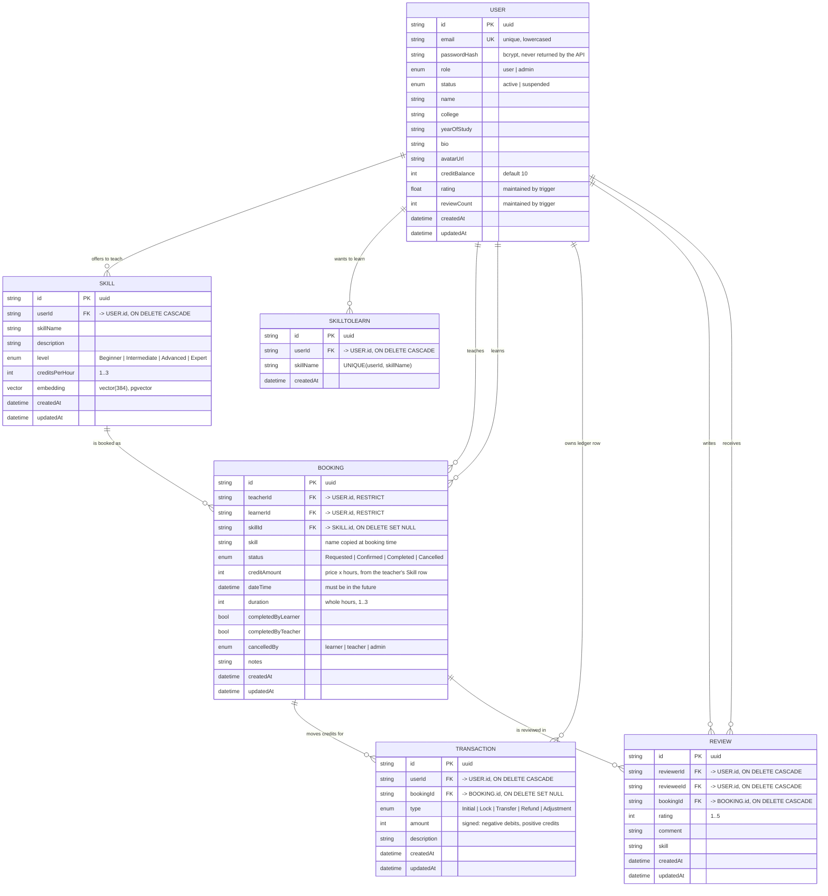

# ER diagram

Six tables in `public`, plus `_prisma_migrations` which Prisma manages and is not
part of the design.

## Relationships, in words

| From | To | Kind | Notes |
|------|----|------|-------|
| User | Skill | 1 : N | What a person teaches. Deleting the user deletes their listings. |
| User | SkillToLearn | 1 : N | What a person wants to learn. `UNIQUE(userId, skillName)` stops duplicates. |
| User | Booking | 1 : N, **twice** | Once as `teacherId`, once as `learnerId`. The same table holds both roles, so one person can teach some sessions and learn in others. |
| Skill | Booking | 1 : N | Nullable. The booking also stores the skill *name*, so history survives the listing being deleted. |
| User | Transaction | 1 : N | The credit ledger. Every balance change writes a row. |
| Booking | Transaction | 1 : N | Nullable — an admin credit adjustment belongs to no booking. |
| User | Review | 1 : N, **twice** | `reviewerId` (written) and `revieweeId` (received). |
| Booking | Review | 1 : N | `UNIQUE(bookingId, reviewerId)` allows at most one review per person per session — so a session yields at most two. |

## Two things worth pointing out

**`Booking` has two foreign keys to the same table.** `teacherId` and `learnerId`
both reference `User.id`. That is what makes a peer-to-peer exchange possible
rather than a one-way tutoring site: there is no separate "teacher" table,
because everybody is both.

**`Booking.teacherId` and `Booking.learnerId` are RESTRICT, not CASCADE.** Every
other foreign key to `User` cascades. These two deliberately do not: deleting
somebody mid-session would erase the other party's history and the credits
attached to it. The application turns the resulting error into a 409 and tells
the admin to suspend the account instead.
